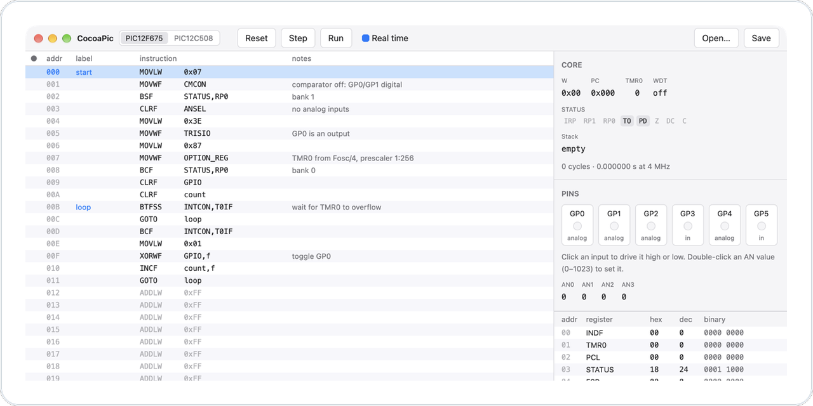

<h1 align="center">CocoaPic</h1>

<p align="center">A simulator for small Microchip PIC microcontrollers, with a native macOS window.</p>

<p align="center">
  <a href="#quick-start"><b>Quick start</b></a> &nbsp;·&nbsp;
  <a href="#documents">Documents</a> &nbsp;·&nbsp;
  <a href="#how-it-works">How it works</a> &nbsp;·&nbsp;
  <a href="docs/simulated.md">What is simulated</a>
</p>

<p align="center">
  
</p>

CocoaPic runs programs for the PIC12F675 and the PIC12C508. Load one from
Intel HEX or `.asm` source, then step or run it while watching the registers,
RAM and pins, poking values, driving inputs and setting breakpoints. With
*Real time* off it runs at roughly 280–440 million instructions a second on an
M-series Mac. It began in 2002 as an Objective-C app; this is a Rust rewrite.

## Quick start

```bash
make run     # open the window on the built-in blink demo
make test    # core and headless window tests
make app     # bundle CocoaPic.app
make         # list the rest
```

The command line runs the same core without the window:

```bash
cocoapic run examples/blink.asm --cycles 1000000   # run, then print the state
cocoapic disasm program.hex                        # a listing
cocoapic asm examples/counter.asm                  # -> counter.hex
```

## Documents

| Document | What's in it |
| -------- | ------------ |
| [The window](docs/window.md) | The program listing, core, pins and RAM panels, editing, breakpoints, shortcuts, and opening and saving |
| [What is simulated](docs/simulated.md) | Both chips in detail, and what isn't simulated |
| [Development](docs/development.md) | The make targets, the command line, benchmarks, the source layout and the rewrite |

## How it works

Each chip is a register file, a stack and its peripherals behind one `step`.
Every instruction word is decoded and executed by a single `match`, shared by
both cores where their instructions agree, with the 12-bit baseline core's
registers, two-level stack and resets kept separately. Most cycles are only
counted: the timers catch up when something is due or a program reads or
reconfigures them, and while the chip sleeps it skips straight ahead to
whatever will wake it. The window is drawn with
[gpui](https://github.com/zed-industries/zed), Zed's UI framework, and its
tests draw the real window without a display.

---

<p align="center"><sub>Part of <a href="https://daleobrien.github.io/#engineering">Engineering</a> &nbsp;·&nbsp; more at <a href="https://daleobrien.github.io">daleobrien.github.io</a></sub></p>
