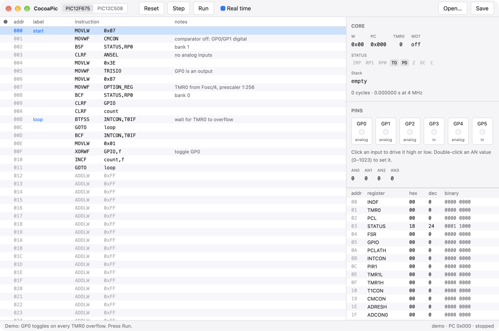

# CocoaPic

A simulator for small Microchip PIC microcontrollers, with a native macOS
window and a command-line runner. Load a program from Intel HEX or `.asm`
source, then step or run it while watching the registers, RAM and pins.



## Build and run

```bash
make build   # release build
make run     # open the window on the built-in blink demo
make test    # core and headless window tests
make bench   # full-speed MIPS on the example programs
make app     # bundle CocoaPic.app
```

`make` on its own lists the rest. The CLI runs programs without the window:

```bash
cocoapic run examples/blink.asm --cycles 1000000
cocoapic disasm program.hex
cocoapic asm examples/counter.asm
```

## Supported chips

- **PIC12F675**, the 14-bit midrange core shared with the PIC16 series: all 35
  instructions, banked registers, the 8-level stack, TMR0, TMR1, the watchdog,
  interrupts, SLEEP, GPIO, the data EEPROM and the A/D converter.
- **PIC12C508**, the 12-bit baseline core: all 33 instructions, the 2-level
  stack, TMR0, the watchdog, SLEEP and wake-on-change.

Pick one with the toolbar switch, `--part 12c508`, or `processor 12c508` in
the source.

CocoaPic began in 2002 as an Objective-C app; this is a Rust rewrite of it.
The PICkit USB reader from the original has not been ported.
