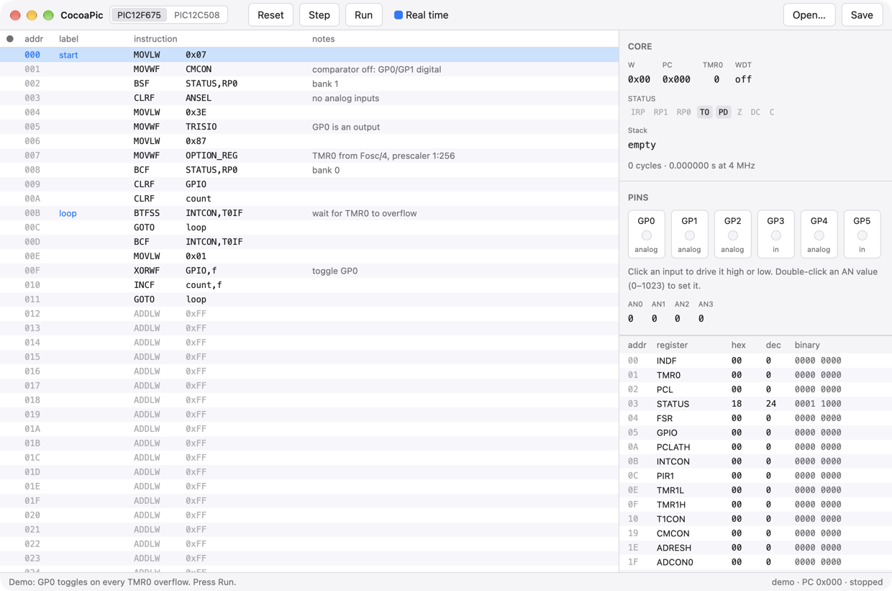

# The window

[Back to the README](../README.md)

`make run` (or `cocoapic`, or `cocoapic gui program.asm`) opens the window on a
program, or on the built-in blink demo.

- **Part**: the toolbar's PIC12F675 / PIC12C508 switch. Switching opens that
  part's demo, since a program for one core means nothing on the other.
- **Program**: all 1024 words (512 on the 12C508). Click the gutter dot for a
  breakpoint. Double-click a label, instruction or note to edit it; an
  instruction is typed as text (`movlw 0x20`, `btfss STATUS,Z`, `goto loop`)
  and assembled on Enter, and Escape cancels. The PC row is tinted and followed
  while stepping.
- **Core**: W and PC (both editable), TMR0, the watchdog's progress, the STATUS
  bits, the stack, the cycle count and the simulated time at 4 MHz.
- **Pins**: GP0–GP5 with their direction and level. Click an input to drive it
  high or low. AN0–AN3 take a value from 0 to 1023 for the A/D converter. On
  the 12C508, which has no A/D, OPTION and TRIS show here instead, since they
  have no address.
- **RAM**: every special register in both banks, then the 64 general-purpose
  bytes, in hex, decimal and binary. Double-click a value to poke it, or a
  general-purpose register's name to name it. Anything that changed since the
  machine last stopped is red, as in the original app.

## Running

| Action | Keys |
| ------ | ---- |
| Run | ⌘R |
| Halt | ⌘. |
| Step | F7 or ⌘' |
| Reset | ⇧⌘R |
| Toggle a breakpoint | ⌘B |

These are also in the toolbar and the Debug menu. *Real time* paces a run at
1 µs per cycle, so a blinking pin can be seen; with it off, the simulator runs
as fast as it can, roughly 280–440 MIPS on an M-series Mac.

## Opening and saving

Programs open from Intel HEX (MPASM or XC8 output, including the configuration
word and EEPROM) or from `.asm` source. A source file names its part with
`processor 12c508` or `list p=12c508`; otherwise it is taken as a 12F675.

Save (⌘S, or ⇧⌘S for Save As) writes `<name>.hex` and a `<name>.cocoapic.json`
sidecar beside it, holding the labels, register names, notes, breakpoints and
part. Opening the hex picks them up again.
